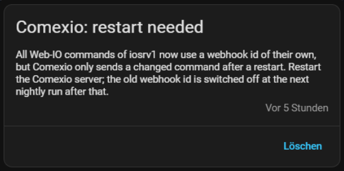

# Comexio — Webhook Security and the Move to Webhook IDs of Their Own

Why every Web-IO command now pushes to a webhook ID of its own, how the switch-over runs on your installation,
and why the Comexio server has to be restarted once.

🇩🇪 [Deutsche Fassung weiter unten](#-deutsch)

## Table of Contents

1. [Why this was necessary](#1-why-this-was-necessary)
2. [What changed](#2-what-changed)
3. [How the switch-over runs](#3-how-the-switch-over-runs)
4. [Why Comexio has to be restarted](#4-why-comexio-has-to-be-restarted)
5. [What you have to do](#5-what-you-have-to-do)
6. [Good to know](#6-good-to-know)
7. [Troubleshooting](#7-troubleshooting)

---

## 1. Why this was necessary

Comexio pushes live values to Home Assistant through **webhooks**: the IO server sends a `POST` request to
`/api/webhook/<id>` whenever a marker or an IO changes. Home Assistant's webhook endpoint takes **no login**.
The `<id>` in the path is the only thing that tells a real push from a forged one.

Until now all Web-IO commands of an installation shared one ID, `comexio_<server name>`. That ID had two weaknesses:

- It can be **guessed**: it is built from the server name, which is visible in Home Assistant.
- It is **worth everything at once**: whoever knows it can set the value of *every* marker and IO, for example by
  sending a request through a reverse proxy or any other route that reaches Home Assistant.

The review of the integration for the HACS default list pointed this out, so the ID was reworked.

## 2. What changed

- **Every Web-IO command has an ID of its own.** The ID is not stored in a list. It is derived (HMAC-SHA256, 128 bit)
  from a **secret** of your installation and the command's address (its class plus the marker number or the
  extension and IO). Nobody can work it out without the secret, and one ID reveals nothing about another.
- **The ID and the payload must belong together.** A request on the ID of marker 7 is only accepted if it also says
  "marker 7". An ID read from one command can therefore only ever set the value of that one command.
- **The payload names the server** (`server="<name>"`). A push meant for another Comexio server is refused.
- **The secret stays in Home Assistant**, in a storage file of its own (`.storage/comexio_webhook_security_<entry id>`).
  It is not part of the config entry, so diagnostics downloads and config entry exports do not show it.
- **Notifications and logs never contain these IDs.** Refused requests are logged without their payload and at most
  once a minute per kind, so nobody can flood the log through the open endpoint.

Only the **path and the payload text** of the Web-IO commands change. The protocol (HTTP/HTTPS) and the address of
the commands stay exactly as they are. Entities, names and automations are not touched.

## 3. How the switch-over runs

The commands live in Comexio, so they have to be rewritten there. The integration does this on its own:

1. **After the update**, Home Assistant accepts the **old ID and the new ones side by side**. Nothing stops
   working, and the commands that have not been rewritten yet keep pushing to the old ID.
2. **Every night at 01:30** the integration rewrites the commands that still use the old ID. It does so within a time
   budget of 3.5 hours per night and remembers which commands are done (the *ledger*), so a large installation simply
   continues the next night. Commands that a sync creates from now on are born with their own ID.
3. **When all commands are rewritten**, the notification **"Comexio: restart needed"** appears (see
   [section 4](#4-why-comexio-has-to-be-restarted)).

4. **You restart the Comexio server.** It reads its Web-IO commands again and from then on pushes to the new IDs.
5. **At the next nightly run after the restart** the integration reads **every command back from Comexio** and checks
   that it holds its own path and the `server=` field. Only if all of them do, the **old ID is switched off for
   good**, and the notification disappears. A command that deviates goes back into the ledger and is rewritten
   again; that needs another restart afterwards.

You can follow the progress in the Home Assistant log (`Webhook id migration: N rewritten, N failed, N left`). The
last line of a finished switch-over is `Old webhook id switched off: every Web-IO command uses its own`.

## 4. Why Comexio has to be restarted

Comexio does not apply a **changed** Web-IO command while it is running. It keeps sending the command as it read it
at boot. Only after a restart does it send the new definition (measured on a live installation: a changed command
takes effect only after the restart).

For the switch-over this means: right after the integration has rewritten a command, Comexio **still pushes to the
old ID**. If the old ID were switched off at that point, every push would be refused and the entities would only
catch up at the next poll (default every 15 minutes). That is why the integration

- keeps the old ID on until Comexio has **restarted after the last rewritten command**. It knows this from the boot
  time of the Comexio server (the same value as the *Last boot* sensor), and
- reads every command back before it switches the old ID off, instead of trusting its own record.

A restart before the commands are rewritten does not count; the integration waits for one after the last write.

## 5. What you have to do

Nothing, until the notification **"Comexio: restart needed"** appears. Then:

1. Restart the Comexio server (a short outage of the IO server, plan it like any other restart).
2. Leave the rest to the integration. The old ID is switched off at the next nightly run (01:30) after the restart,
   and the notification disappears.

If you have no reason to wait, you can restart Comexio right after the notification appears. If a sync or a
reconfiguration writes commands again later, the notification returns and one more restart is due.

## 6. Good to know

- **No pushes get lost** during the switch-over: both IDs work until the very end.
- **A new Comexio host** (the address of the entry changes): the old ID is switched on again until every command of
  the new host has its own ID. The integration then reads the commands from the new host and rewrites the ones that
  differ.
- **Lost secret:** if the storage file is unreadable, the integration creates a new secret and logs an error. Commands
  that already use IDs of the old secret are refused until the nightly run rewrites them again.
- **Not part of this change:** an additional **Basic Auth** login on the Web-IO commands follows separately.

## 7. Troubleshooting

- **The notification "Comexio: restart needed" does not go away:** restart the Comexio server, then wait for the next
  nightly run (01:30). If it stays, the log names the reason: commands that could not be read back or deviate are
  listed by name.
- **`failed` commands in the log:** Comexio refused or did not answer a rewrite (busy, offline). The next night tries
  again.
- **Values arrive late after a Comexio restart:** that is expected for a moment; the integration polls the current
  values as usual.
- **Log lines `Webhook request refused` or `Webhook payload for server … dropped`:** a request reached Home Assistant
  with an ID that does not belong to its payload, or for another server. If you did not just change the switch-over, check who can reach your Home
  Assistant from outside.

---

# 🇩🇪 Deutsch

# Comexio — Webhook-Absicherung und die Umstellung auf eigene Webhook-IDs

Warum jedes Web-IO-Command jetzt an eine eigene Webhook-ID pusht, wie die Umstellung bei dir abläuft und warum der
Comexio-Server einmal neu gestartet werden muss.

## Inhaltsverzeichnis

1. [Warum das nötig war](#1-warum-das-nötig-war)
2. [Was sich ändert](#2-was-sich-ändert)
3. [Wie die Umstellung abläuft](#3-wie-die-umstellung-abläuft)
4. [Warum Comexio neu gestartet werden muss](#4-warum-comexio-neu-gestartet-werden-muss)
5. [Was du tun musst](#5-was-du-tun-musst)
6. [Gut zu wissen](#6-gut-zu-wissen)
7. [Fehlerbehebung](#7-fehlerbehebung)

---

## 1. Warum das nötig war

Comexio schickt Live-Werte über **Webhooks** an Home Assistant: Der IO-Server sendet einen `POST` an
`/api/webhook/<id>`, sobald sich ein Merker oder ein IO ändert. Der Webhook-Endpunkt von Home Assistant verlangt
**keinen Login**. Die `<id>` im Pfad ist das Einzige, was einen echten Push von einem gefälschten unterscheidet.

Bisher teilten sich alle Web-IO-Commands einer Anlage eine ID, `comexio_<Servername>`. Sie hatte zwei Schwächen:

- Sie ist **erratbar**: Sie besteht aus dem Servernamen, und der ist in Home Assistant sichtbar.
- Sie ist **auf einmal alles wert**: Wer sie kennt, kann den Wert *jedes* Merkers und IOs setzen, etwa über einen
  Reverse-Proxy oder jeden anderen Weg, der Home Assistant erreicht.

Das Review der Integration für die HACS-Standardliste hat darauf hingewiesen, deshalb wurde die ID überarbeitet.

## 2. Was sich ändert

- **Jedes Web-IO-Command hat eine eigene ID.** Die ID steht in keiner Liste. Sie wird (HMAC-SHA256, 128 Bit) aus einem
  **Geheimnis** deiner Anlage und der Adresse des Commands abgeleitet (Klasse plus Merkernummer bzw. Erweiterung und
  IO). Ohne das Geheimnis kann sie niemand ausrechnen, und eine ID verrät nichts über eine andere.
- **ID und Inhalt müssen zusammenpassen.** Eine Anfrage an die ID von Merker 7 wird nur angenommen, wenn sie auch
  „Merker 7“ sagt. Eine von einem Command mitgelesene ID kann deshalb nur den Wert genau dieses Commands setzen.
- **Der Inhalt nennt den Server** (`server="<Name>"`). Ein Push für einen anderen Comexio-Server wird abgewiesen.
- **Das Geheimnis bleibt in Home Assistant**, in einer eigenen Speicherdatei
  (`.storage/comexio_webhook_security_<Entry-ID>`). Es liegt nicht im Config-Entry und taucht deshalb weder im
  Diagnose-Download noch in Exporten des Config-Entrys auf.
- **Benachrichtigungen und Logs enthalten diese IDs nie.** Abgewiesene Anfragen werden ohne ihren Inhalt und
  höchstens einmal pro Minute und Art protokolliert, damit niemand das Log über den offenen Endpunkt fluten kann.

Nur **Pfad und Inhalt** der Web-IO-Commands ändern sich. Protokoll (HTTP/HTTPS) und Adresse der Commands bleiben
genau, wie sie sind. Entitäten, Namen und Automationen bleiben unberührt.

## 3. Wie die Umstellung abläuft

Die Commands liegen in Comexio, also müssen sie dort umgeschrieben werden. Das macht die Integration selbst:

1. **Nach dem Update** akzeptiert Home Assistant die **alte ID und die neuen nebeneinander**. Nichts hört auf zu
   funktionieren, und Commands, die noch nicht umgeschrieben sind, pushen weiter an die alte ID.
2. **Jede Nacht um 01:30** schreibt die Integration die Commands um, die noch die alte ID nutzen. Sie hat dafür ein
   Zeitbudget von 3,5 Stunden pro Nacht und merkt sich, welche Commands fertig sind (das *Ledger*). Eine große Anlage
   setzt also einfach in der nächsten Nacht fort. Commands, die ein Sync ab jetzt anlegt, bekommen gleich ihre eigene ID.
3. **Sind alle Commands umgeschrieben**, erscheint die Benachrichtigung **„Comexio: restart needed“** (siehe
   [Abschnitt 4](#4-warum-comexio-neu-gestartet-werden-muss)).

4. **Du startest den Comexio-Server neu.** Er liest seine Web-IO-Commands neu ein und pusht von da an an die neuen IDs.
5. **Beim nächsten Nachtlauf nach dem Neustart** liest die Integration **jedes Command aus Comexio zurück** und prüft,
   dass es seinen eigenen Pfad und das Feld `server=` trägt. Nur wenn alle das tun, wird die **alte ID endgültig
   abgeschaltet** und die Benachrichtigung verschwindet. Ein abweichendes Command kommt zurück ins Ledger und wird
   erneut umgeschrieben; danach ist ein weiterer Neustart nötig.

Den Fortschritt siehst du im Home-Assistant-Log (`Webhook id migration: N rewritten, N failed, N left`). Die letzte
Zeile einer abgeschlossenen Umstellung lautet `Old webhook id switched off: every Web-IO command uses its own`.

## 4. Warum Comexio neu gestartet werden muss

Comexio übernimmt ein **geändertes** Web-IO-Command nicht im laufenden Betrieb. Es sendet das Command so weiter, wie
es beim Start eingelesen wurde. Erst nach einem Neustart sendet es die neue Definition (an einer Live-Anlage gemessen:
ein geändertes Command wirkt erst nach dem Neustart).

Für die Umstellung heißt das: Direkt nachdem die Integration ein Command umgeschrieben hat, pusht Comexio **noch an die
alte ID**. Würde die alte ID in diesem Moment abgeschaltet, würde jeder Push abgewiesen, und die Entitäten würden erst
beim nächsten Poll (Standard alle 15 Minuten) nachziehen. Deshalb

- lässt die Integration die alte ID an, bis Comexio **nach dem zuletzt umgeschriebenen Command neu gestartet** ist.
  Das erkennt sie an der Startzeit des Comexio-Servers (derselbe Wert wie im Sensor *Letzter Start*), und
- liest sie jedes Command zurück, bevor sie die alte ID abschaltet, statt sich auf ihre eigene Buchführung zu verlassen.

Ein Neustart, bevor die Commands umgeschrieben sind, zählt nicht; die Integration wartet auf einen nach dem letzten
Schreiben.

## 5. Was du tun musst

Nichts, bis die Benachrichtigung **„Comexio: restart needed“** erscheint. Dann:

1. Starte den Comexio-Server neu (kurzer Ausfall des IO-Servers, plane ihn wie jeden anderen Neustart).
2. Den Rest erledigt die Integration. Die alte ID wird beim nächsten Nachtlauf (01:30) nach dem Neustart abgeschaltet,
   und die Benachrichtigung verschwindet.

Wenn nichts dagegen spricht, kannst du Comexio gleich nach dem Erscheinen der Benachrichtigung neu starten. Schreibt
später ein Sync oder eine Neukonfiguration wieder Commands, kehrt die Benachrichtigung zurück, und ein weiterer
Neustart steht an.

## 6. Gut zu wissen

- **Es gehen keine Pushes verloren:** Beide IDs funktionieren bis zum Schluss.
- **Neuer Comexio-Host** (die Adresse des Eintrags ändert sich): Die alte ID wird wieder eingeschaltet, bis jedes
  Command des neuen Hosts eine eigene ID hat. Die Integration liest die Commands dann vom neuen Host und schreibt die
  abweichenden um.
- **Verlorenes Geheimnis:** Ist die Speicherdatei unlesbar, erzeugt die Integration ein neues Geheimnis und
  protokolliert einen Fehler. Commands mit IDs des alten Geheimnisses werden abgewiesen, bis der Nachtlauf sie erneut
  umschreibt.
- **Nicht Teil dieser Änderung:** Eine zusätzliche **Basic-Auth**-Anmeldung an den Web-IO-Commands folgt separat.

## 7. Fehlerbehebung

- **Die Benachrichtigung „Comexio: restart needed“ verschwindet nicht:** Starte den Comexio-Server neu und warte auf
  den nächsten Nachtlauf (01:30). Bleibt sie, nennt das Log den Grund: Commands, die sich nicht zurücklesen lassen oder
  abweichen, stehen namentlich darin.
- **`failed`-Commands im Log:** Comexio hat ein Umschreiben abgelehnt oder nicht geantwortet (beschäftigt, offline). Die
  nächste Nacht versucht es erneut.
- **Werte kommen nach einem Comexio-Neustart verspätet:** Das ist für einen Moment normal; die Integration fragt die
  aktuellen Werte wie gewohnt ab.
- **Logzeilen `Webhook request refused` oder `Webhook payload for server … dropped`:** Eine Anfrage kam mit einer ID
  an, die nicht zu ihrem Inhalt passt, oder für einen anderen Server. Hast du nicht gerade die Umstellung laufen, prüfe, wer dein Home Assistant von außen
  erreicht.
